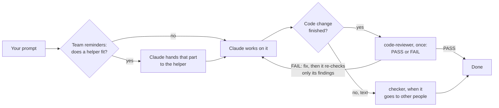
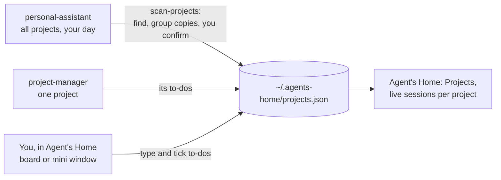

# The team pipeline

How work flows through the Office pack's team in Claude Code. The team
reminders hook (`hooks/agents-home-router.sh`) is what steers it.

## One helper when one fits

Claude does the work itself and hands a part over when a helper
fits it, one at a time.

| Request | Helper |
| --- | --- |
| an email, letter, reply, rewrite | `writer` |
| a summary, key points, action items | `summariser` |
| a plan, schedule, checklist | `planner` |
| tables, numbers, formulas | `data-helper` |
| a second look before it goes out | `checker` |
| a whole code change handed off (feature, refactor, migration) | `builder` (Sonnet), never a general-purpose helper |
| a finished code change (feature, bug, refactor) | `code-reviewer` or `/code-review`, once per change, not both and not after each small fix |
| running tests, a build or a linter | `test-runner`: the tests for the change first, the full suite only when needed |
| where this project stands, what is next, its to-do list | `project-manager` |
| your day across projects, scanning and organising projects | `personal-assistant` (with the `scan-projects` skill) |

## Two managers

The project list is one local JSON file. Every writer reads it fresh,
changes its own part and writes the whole file at once, so nobody's
changes are lost. The assistant saves a scanned list only after you
confirm it.

## Why it is set up this way (report of 2026-10-29)

- General-purpose helpers were 7 runs but 62% of the weighted cost (Opus,
  16 to 29 minutes, all making edits). Whole changes now go to `builder`
  on Sonnet with a brief that names the files and the check.
- Some sessions ran both `/code-review` and `code-reviewer` on one change.
  The reminder now asks for one of them.
- `test-runner` had 9% tool errors. It now uses the project's own command
  as written, checks the shell first (Git Bash on Windows) and never
  repeats a failing command.
- The office helpers (`writer`, `planner`, ...) were not called in 28 days;
  they stay in the pack for non-coding work and cost nothing unless used.

## Worth knowing

- Claude picks helpers by their descriptions; the reminders only make it
  think of them. Nothing is forced.
- Each helper keeps its own rules: keep it simple but useful, plain words,
  never invent facts, never repeat patient identifiers.
- The reminders read the prompt and keep nothing; with nothing to remind,
  they add nothing.
