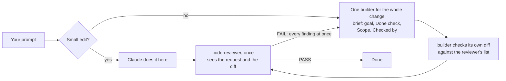
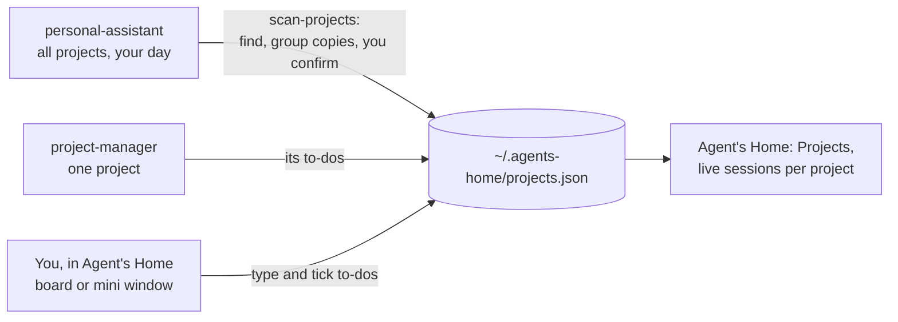

# The team pipeline

How work flows through the Office pack's team in Claude Code. It is a
simpler version of a fuller set-up that was tuned on a few hundred real
helper runs: the rules that paid off are kept, the machinery is left out.
The team reminders hook (`hooks/agents-home-router.sh`) is what steers it.

## Code: one builder, one review

- **Small edits stay in the main session.** Anything bigger goes to *one*
  `builder` for the whole change, its pieces as a checklist. Work is split
  only when a piece fails twice, not up front: each extra helper starts
  from nothing and loses what the others knew.
- **The brief** names the goal, a `Done check:` (the test or command that
  proves it works), a `Scope:` (which files) and `Checked by:` (who
  reviews). Briefs without a done check were the most common reason a
  helper wandered or stopped early.
- **The builder checks itself first** against the reviewer's list, stays
  inside its scope, stops after two failed fixes of one check, and hands
  back at the last passing step when a job runs long.
- **The reviewer sees the request and the diff, never the builder's own
  report**, so it judges the code, not the story about it. It also looks
  for errors that fail silently (caught and ignored, a default that hides
  a missing value), which an ordinary review often passes. All findings
  come in one round, go back to the same builder, and only those are
  re-checked. The last line is `VERDICT: PASS` or `VERDICT: FAIL`.
- **Tests and builds** go to `test-runner`, which reports in a few lines
  instead of flooding the conversation.

## Everything else: one helper when one fits

| Request | Helper |
| --- | --- |
| an email, letter, reply, rewrite | `writer` |
| a summary, key points, action items | `summariser` |
| "make me a plan / schedule / checklist" | `planner` |
| spreadsheets, formulas, pivot tables | `data-helper` |
| a second look before it goes out | `checker` |
| anything bigger than a small code edit | `builder` (Sonnet), one per change |
| a finished code change | `code-reviewer`, once per change |
| running tests, a build or a linter | `test-runner`: the tests for the change first |
| where this project stands, its to-do list | `project-manager` |
| your day across projects, scanning for projects | `personal-assistant` (with `scan-projects`) |

The reminders stay quiet when a background helper reports back, and
`planner` and `data-helper` are suggested only when asked for outright,
since "plan" and "calculate" turn up in most coding prompts.

## Two managers

The project list is one local JSON file. Every writer reads it fresh,
changes its own part and writes the whole file at once, so nobody's
changes are lost. The assistant saves a scanned list only after you
confirm it.

## Left out on purpose

The fuller set-up adds these. Each needs its own hooks or upkeep, so add
them yourself if your work calls for it:

- a hook that sends a builder's brief back when it has no done check or scope;
- a ledger of every review verdict, and track records per agent from it;
- a context cap that asks for a handoff file past a set size;
- a shared board so two chats in one repository see each other's edits
  (Agent's Home warns when two sessions work in one folder);
- separate reviewers for data paths and for screens, alongside the code review;
- several builders trying different approaches on a piece that failed twice.

## Worth knowing

- Claude picks helpers by their descriptions; the reminders only make it
  think of them. Nothing is forced.
- Each helper keeps its own rules: keep it simple but useful, plain words,
  never invent facts, never repeat patient identifiers.
- The reminders read the prompt and keep nothing; with nothing to remind,
  they add nothing.
